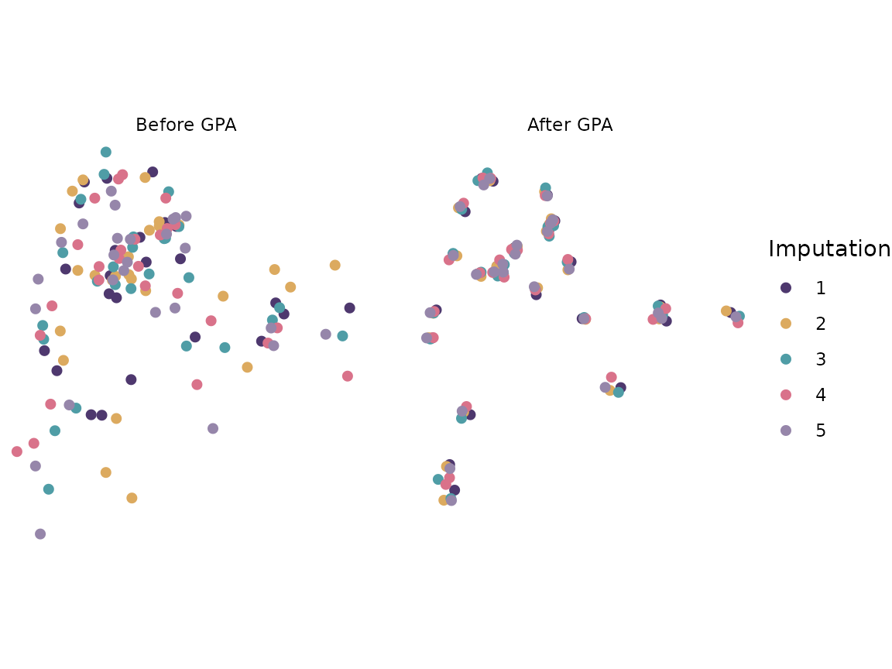
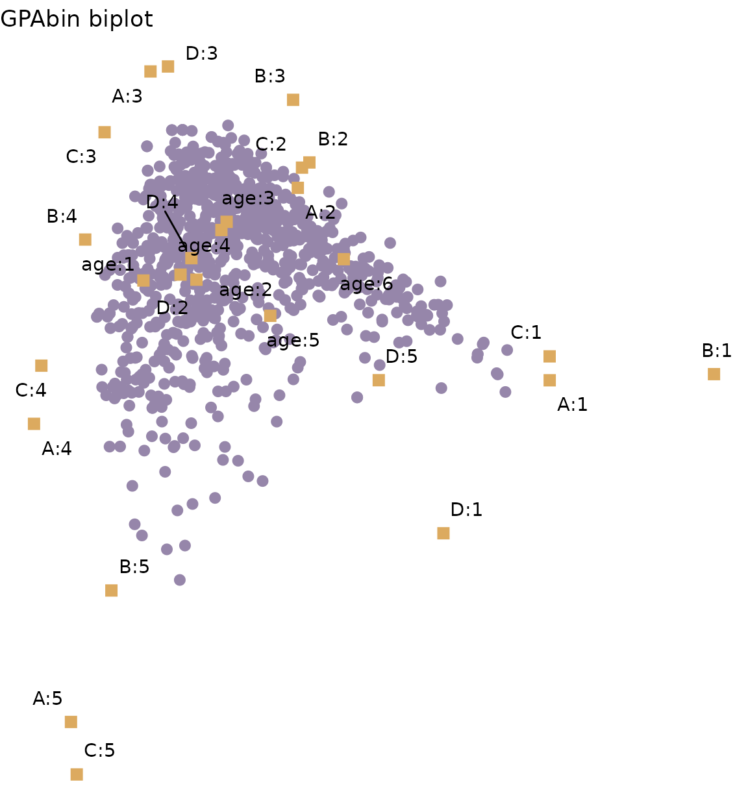
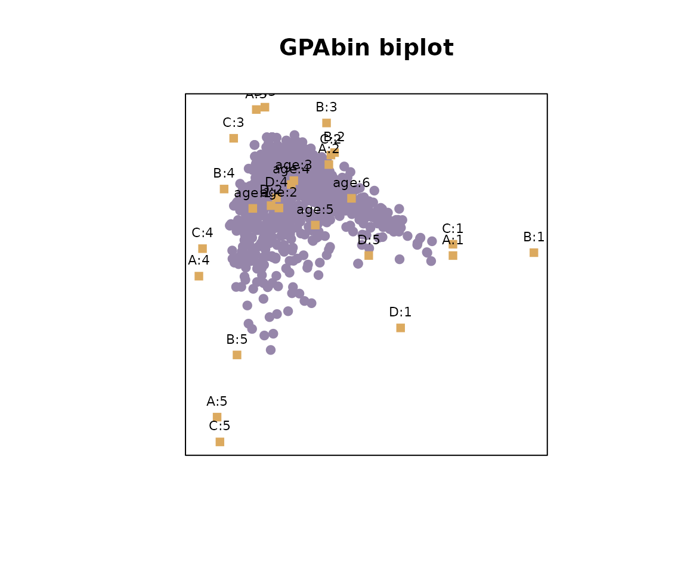
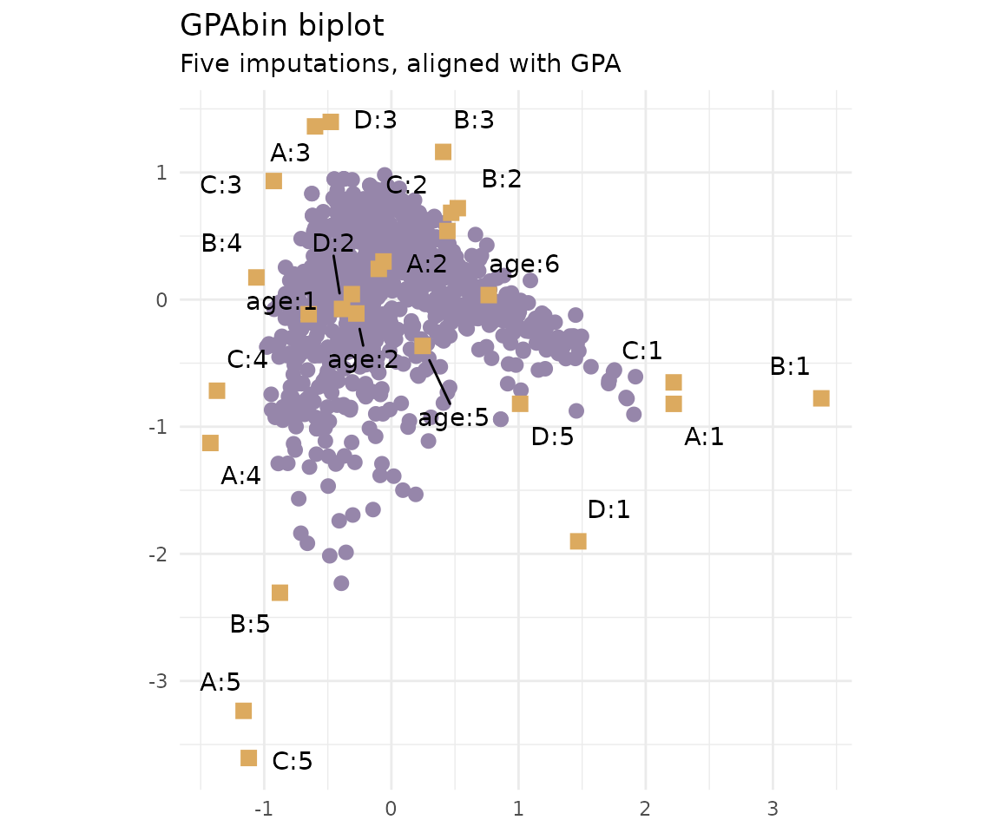
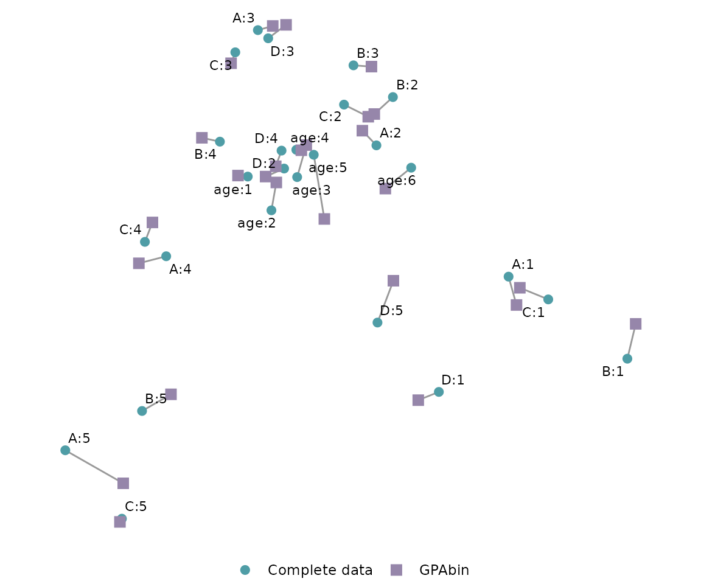

# Getting started with GPAbin

## Why GPAbin?

Multiple imputation replaces each missing value with several plausible
values, giving you $`m`$ completed data sets instead of one. Numerical
summaries such as means and regression coefficients are then combined
with Rubin’s rules. But what do you do when the “summary” is a
*picture*?

If you construct a biplot from each completed data set, you get $`m`$
slightly different pictures. You cannot simply average their
coordinates, because a dimension reduction solution is only determined
up to rotation and reflection: the same configuration can come out
flipped, spun or mirrored from one imputation to the next. Averaging
unaligned coordinates would blur the display into nonsense.

`GPAbin` solves this in three steps (Nienkemper-Swanepoel, le Roux and
Gardner-Lubbe, 2023):

1.  construct a biplot for every imputed data set;
2.  use **g**eneralised orthogonal **P**rocrustes **a**nalysis (GPA) to
    translate, rotate, reflect and scale all configurations onto a
    common target;
3.  average the aligned coordinates, mimicking the pooling step of
    Ru**bin**’s rules, and draw a single unified **GPAbin biplot**.

The current version works with **categorical data**, using multiple
correspondence analysis (MCA) as the dimension reduction technique. In
the resulting biplot, points represent samples / observations and
*category level points* (CLPs) represent the response categories of each
variable.

## Installation

### CRAN

``` r

install.packages("GPAbin")
```

### Development version

``` r

devtools::install_github("jnienk/GPAbin")
```

## The workflow at a glance

Every step takes a `missmi` object and returns it with new elements
added, so the whole analysis can be written as one native pipe (`|>`):

``` r

missbp <- missmi(implist) |>
  DRT() |>
  GPAbin() |>
  evaluation(compdat = compdat) |>
  plot()
```

| Step | Function | What it does |
|----|----|----|
| 1 | [`missmi()`](https://jnienk.github.io/GPAbin/reference/missmi.md) | Prepares the input (a data frame with missing values, or a list of imputed data sets) |
| 2 | [`impute()`](https://jnienk.github.io/GPAbin/reference/impute.md) | *Optional.* Multiply imputes a data frame with missing values |
| 3 | [`DRT()`](https://jnienk.github.io/GPAbin/reference/DRT.md) | Dimension reduction (MCA) on each imputed data set |
| 4 | [`GPAbin()`](https://jnienk.github.io/GPAbin/reference/GPAbin.md) | Aligns the configurations with GPA and combines them |
| 5 | [`evaluation()`](https://jnienk.github.io/GPAbin/reference/evaluation.md) | *Optional.* Compares against a complete data solution, when one exists |
| 6 | [`plot()`](https://rdrr.io/r/graphics/plot.default.html) | Draws the biplot (`ggplot2` or base graphics) |

## The data: attitudes towards science

We use a real survey data set that is included in the `ca` package:
`wg93`, the West German sample of the 1993 *International Social Survey
Programme* (ISSP) on the environment. It contains 871 respondents. Four
questions (`A` to `D`) measure attitudes towards science on a five-point
scale (1 = agree strongly to 5 = disagree strongly) and three
demographic variables record sex, age group and education. We keep the
four attitude items together with age group (six levels), giving five
categorical variables.

``` r

data("wg93", package = "ca")
compdat <- wg93[, c("A", "B", "C", "D", "age")]
str(compdat)
#> 'data.frame':    871 obs. of  5 variables:
#>  $ A  : Factor w/ 5 levels "1","2","3","4",..: 2 3 2 2 3 3 3 3 3 3 ...
#>  $ B  : Factor w/ 5 levels "1","2","3","4",..: 3 4 3 2 3 4 4 4 2 3 ...
#>  $ C  : Factor w/ 5 levels "1","2","3","4",..: 4 2 2 2 3 4 2 4 2 2 ...
#>  $ D  : Factor w/ 5 levels "1","2","3","4",..: 3 3 4 2 3 5 4 2 1 2 ...
#>  $ age: Factor w/ 6 levels "1","2","3","4",..: 2 3 3 2 5 3 5 3 3 3 ...
```

Take note: All variables must be **factors**; `wg9`

### Creating missing values

This data set is complete, which is useful: we can delete some values on
purpose and then check how well `GPAbin` recovers the original picture.
In reality, you would of course skip this step and start the pipeline
with your incomplete data set.

We generate values that are *missing at random* (MAR): the chance that a
person skips questions `A` to `D` depends only on their age group, which
is fully observed, and increases with the age-group code (from 10% to
50%).

``` r

set.seed(2024)
p_miss <- c(0.10, 0.15, 0.20, 0.30, 0.40, 0.50)[as.integer(compdat$age)]

missdat <- compdat
for (v in c("A", "B", "C", "D")) {
  missdat[runif(nrow(missdat)) < p_miss, v] <- NA
}

round(colMeans(is.na(missdat)) * 100, 1)  
#>    A    B    C    D  age 
#> 26.3 27.1 27.1 25.0  0.0
```

About a quarter of the answers to each attitude question are now
missing.

## Step 1: `missmi()`

[`missmi()`](https://jnienk.github.io/GPAbin/reference/missmi.md) is the
entry point. It checks the data, records key dimensions and the
percentage of missing values and creates an object of class `missmi`.
The printed summary reports: the number of imputations (`m`), the number
of samples (`n`), the number of variables (`p`) and the percentage of
missing values (`miss_pct`).

It accepts either a data frame containing missing values or a list of
already imputed data sets.

``` r

missbp <- missmi(missdat)
missbp
#> [1] "Missing data with a total of 21 % missing values."
round(missbp$miss_pct, 1)
#>    A    B    C    D  age 
#> 26.3 27.1 27.1 25.0  0.0
```

If your data contain no missing values,
[`missmi()`](https://jnienk.github.io/GPAbin/reference/missmi.md) stops
with a message, because there is nothing to impute.

## Step 2: `impute()`

[`impute()`](https://jnienk.github.io/GPAbin/reference/impute.md)
creates $`m`$ imputed data sets with one of four available methods:

| `imp.method` | Approach | Underlying function |
|:---|:---|:---|
| `"MIMCA"` | Multiple imputation with MCA (the default) | [`missMDA::MIMCA()`](https://rdrr.io/pkg/missMDA/man/MIMCA.html) |
| `"jomo"` | Joint modelling for categorical data | [`jomo::jomo1cat()`](https://rdrr.io/pkg/jomo/man/jomo1cat.html) |
| `"miceB"` | Bayesian chained equations | [`mi::mi()`](https://rdrr.io/pkg/mi/man/04mi.html) |
| `"mice"` | Chained equations with polytomous regression | [`mice::mice()`](https://amices.org/mice/reference/mice.html) |

We use `"miceB"` with $`m = 5`$ imputations. Setting a seed makes the
result reproducible.

``` r

set.seed(927)
missbp <- impute(missbp, imp.method = "miceB", m = 5)
```

The imputed data sets are stored in `missbp$dataimp`, a list with one
data frame per imputation. They are complete:

``` r

missbp$m
#> [1] 5
anyNA(missbp$dataimp[[1]])
#> [1] FALSE
```

## Step 3: `DRT()`

[`DRT()`](https://jnienk.github.io/GPAbin/reference/DRT.md) (dimension
reduction technique) runs an MCA on each of the five imputed data sets.
For each imputation it stores the sample coordinates (`Z`), the category
level point coordinates (`CLP`) and the level names (`lvls`).

``` r

missbp <- DRT(missbp)

length(missbp$Z)            
#> [1] 5
dim(missbp$Z[[1]])          
#> [1] 871  21
head(missbp$lvls[[1]], 6)   
#> [1] "A:1" "A:2" "A:3" "A:4" "A:5" "B:1"
```

Each of these five solutions is a perfectly valid MCA, but they are not
yet comparable: nothing forces the five configurations to share the same
orientation. That is what the next step takes care of.

## Step 4: Align and combine with `GPAbin()`

This is the core of the package.
[`GPAbin()`](https://jnienk.github.io/GPAbin/reference/GPAbin.md) aligns
the *m* configurations with generalised orthogonal Procrustes analysis
and then averages the aligned coordinates.

``` r

missbp <- missbp |> GPAbin()
```

Four new elements are added to the object:

| Element | Contents |
|:---|:---|
| `Z.GPA.list` | Aligned sample coordinates, one matrix per imputation |
| `CLP.GPA.list` | Aligned category level points, one matrix per imputation |
| `Z.GPAbin` | **Average** sample coordinates, used for the GPAbin biplot |
| `CLP.GPAbin` | **Average** category level points, used for the GPAbin biplot |

To see what GPA did, we plot the category level points of all five
imputations (first two dimensions, one colour per imputation) before and
after alignment.



On the left, the five MCA solutions are scattered: every imputation
produced a differently rotated or reflected picture, so a simple average
would be meaningless. On the right, after GPA, each category level is
represented by a tight cluster of five points. Averaging within each
cluster gives the coordinates in `CLP.GPAbin`.

By default the centroid configuration is used as the target. You can
supply your own through the `G.target` argument if you want to align to
a particular reference configuration.

## Step 5: `plot()`

[`plot()`](https://rdrr.io/r/graphics/plot.default.html) draws the
GPAbin biplot. By default it uses `ggplot2`; use `engine = "base"` for
base graphics.

``` r

missbp <- plot(missbp, 
               title = "GPAbin biplot", 
               CLP.col = "#DCAA5F", 
               Z.col = "#9686AA")
```



Dark points are respondents; gold squares are the category level points,
labelled `variable:level`. A respondent tends to have answered a
question with the category whose point lies nearest to them. The overall
shape is the arch that is typical of MCA on ordered response scales: for
questions `A`, `B` and `C` the extreme categories 1 and 5 lie at
opposite ends of the arch and the neutral category 3 sits at its apex.
The age groups are all found near the centre of the display, so age is
only weakly related to the attitude responses. Take note: the
orientation of a biplot is arbitrary: a mirrored or rotated version
carries exactly the same information.

[`plot()`](https://rdrr.io/r/graphics/plot.default.html) returns the
`missmi` object with the plot stored in `missbp$plot`.

### Base graphics

``` r

missbp |> plot(engine = "base", 
               title = "GPAbin biplot", 
               CLP.col = "#DCAA5F", 
               Z.col = "#9686AA")
#> [1] "Missing data with a total of 21 % missing values."
```



### ggplot2

Because these are ordinary `ggplot` objects, you can customise them
further with the usual `ggplot2` layers and themes:

``` r

missbp$plot + 
  labs(subtitle = "Five imputations, aligned with GPA") + 
  theme_minimal()
```



## Step 6 (optional): evaluating against the complete data

Because we created the missing values ourselves, we know what the biplot
of the *complete* data looks like.
[`evaluation()`](https://jnienk.github.io/GPAbin/reference/evaluation.md)
performs an MCA on the complete data supplied through `compdat`, and
compares it with the GPAbin biplot. This is only possible for simulation
studies or examples like this one.

``` r

missbp <- evaluation(missbp, compdat = compdat)
missbp$eval.tab
```

|      | Evaluation measures |
|:-----|--------------------:|
| 1-PS |              0.8089 |
| SP   |              0.8581 |
| RPR  |              0.4914 |
| AMB  |              0.2100 |
| RMSB |              0.2963 |

The table contains five measures:

- **1-PS**: one minus the Procrustes statistic. It measures how closely
  the two configurations match after the best possible rotation. Values
  close to 1 are good.
- **SP** (similarity proportion): the proportion of all responses for
  which the category predicted from the GPAbin biplot equals the
  category in the complete data. Observed responses are kept as they
  are, so they count as correct by construction. Only the missing cells
  are actually predicted. Again, values close to 1 are good.
- **RPR** (response profile recovery): the proportion of respondents
  whose *entire* response profile is recovered correctly. This is a much
  stricter criterion than SP, with values close to 1 again reflecting
  successful recovery.
- **AMB** and **RMSB**: the absolute mean bias and root mean squared
  bias between the two configurations. Smaller values are better. They
  are hard to interpret on their own and are intended for comparing
  competing approaches applied to the same data.

[`evaluation()`](https://jnienk.github.io/GPAbin/reference/evaluation.md)
also stores the complete data coordinates in `compZs`, `compCLPs` and
`complvls`, with the predicted categorical data sets in `GPApred` and
`compPred`. We can use these to draw the two sets of category level
points on top of each other. The orientation of a biplot is arbitrary,
so we first rotate the GPAbin coordinates onto the complete data
solution with a small orthogonal Procrustes helper.

The following figure can be constructed from the available output and is
not currently available in the package:



Each grey segment links a category level’s position in the complete data
biplot to its position in the GPAbin biplot. Most segments are short:
even with about a quarter of the attitude responses missing, the unified
display stays close to the picture we would have obtained with no
missing data. The largest displacements occur for the rarely chosen
extreme categories (such as `A:5` and `C:5`), which are the hardest to
place when many of their responses are missing.

## Already have your imputations?

[`impute()`](https://jnienk.github.io/GPAbin/reference/impute.md) is a
convenience. If you prefer to create the imputations yourself, for
example with `mice`, pass the list of completed data sets straight to
[`missmi()`](https://jnienk.github.io/GPAbin/reference/missmi.md). A
list is recognised as “already imputed”, so
[`impute()`](https://jnienk.github.io/GPAbin/reference/impute.md) is
skipped.

``` r

imp <- mice::mice(missdat, m = 5, method = "polyreg", maxit = 5,
                  printFlag = FALSE, seed = 1)
implist_own <- mice::complete(imp, "all")   # list of 5 completed data frames

own <- missmi(implist_own) |> DRT() |> GPAbin()
own
#> [1] "There are 5 imputations / variations of your data available."
```

The package also includes ready-made simulated examples, `missdat` (a
data frame with about 35% missing values), `implist` (five imputations
of it) and `compdat` (the complete data), which are handy for trying out
the functions quickly:

``` r

data(implist)
missmi(implist) |> DRT() |> GPAbin() |> plot() |> evaluation(compdat = compdat)
```

## Good to know

- The current version supports categorical variables and MCA only.
- The biplot is displayed in two dimensions; the GPA alignment itself
  uses all available dimensions.
- The lower-level building blocks are exported:
  [`GPA()`](https://jnienk.github.io/GPAbin/reference/GPA.md)
  (generalised Procrustes analysis of any list of configurations),
  [`OPA()`](https://jnienk.github.io/GPAbin/reference/OPA.md)
  (orthogonal Procrustes analysis) and
  [`CLPpred()`](https://jnienk.github.io/GPAbin/reference/CLPpred.md)
  (predicting categories from a biplot). See their help pages for
  details.
- The `GPAbin` approach is not limited to imputations: it can combine
  variations of a visualisation of the same data, such as bootstrap
  resamples or data collected over time.

## References

Nienkemper-Swanepoel, J., le Roux, N. J. and Gardner-Lubbe, S. (2023).
GPAbin: unifying visualizations of multiple imputations for missing
values. *Communications in Statistics - Simulation and Computation*,
52(6), 2666-2685. <https://doi.org/10.1080/03610918.2021.1914089>

ISSP Research Group (1993). *International Social Survey Programme:
Environment*. <http://www.issp.org>
